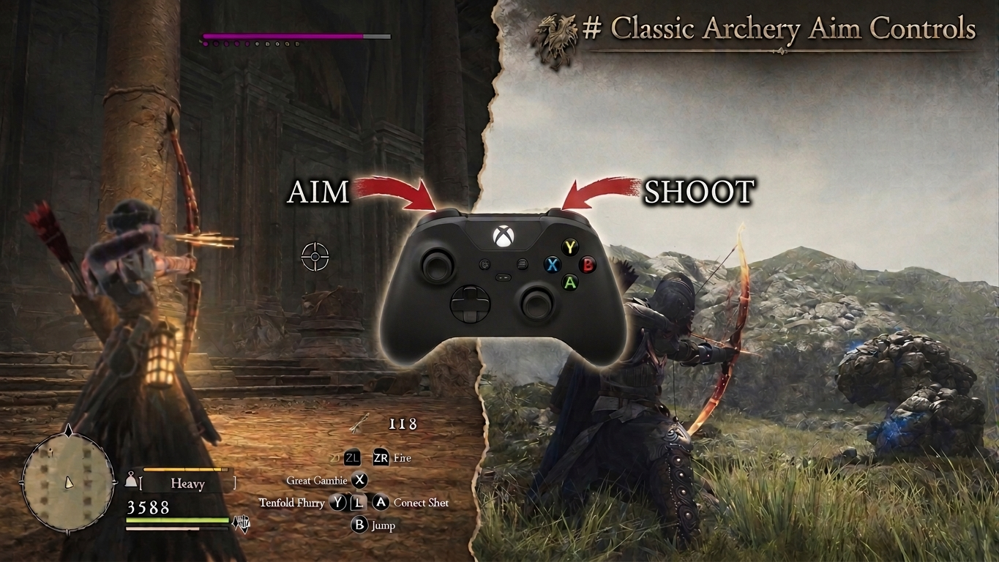

# Classic Aim Controls

[](#)
[](#requirements)
[](https://github.com/praydog/REFramework)
[](https://www.nexusmods.com/dragonsdogma2/mods/2553?tab=description)

**Language:** English · [Português (Brasil)](README.pt-BR.md)



Recreates the classic aiming scheme for bows: hold LT to aim, press RT to shoot while continuing to aim, and release LT to cancel aiming without firing an arrow.

## Table of contents

- [What it does](#what-it-does)
- [Controls](#controls)
- [Requirements](#requirements)
- [Installation](#installation)
- [Recommended game controls](#recommended-game-controls)
- [Warfarer](#warfarer)
- [Cloudburst Shot and Cataract Shot](#cloudburst-shot-and-cataract-shot)
- [Settings](#settings)
- [Uninstallation](#uninstallation)
- [Compatibility](#compatibility)
- [Bug reports](#bug-reports)
- [Credits and legal notice](#credits-and-legal-notice)

## What it does

Classic Aim Controls is a Lua script for REFramework that restores the classic bow aiming behavior in Dragon's Dogma 2.

Supported vocations and weapon use:

- Archer
- Magick Archer
- Warfarer, only while the equipped weapon is a bow or magick bow; with another weapon, Warfarer keeps the game's original controls

The mod also works with:

- Loaded objects and creatures
- Piercing Dart
- Skill arrows
- Cloudburst Shot
- Cataract Shot

It works in the game's input layer and follows the gamepad buttons configured by the player.

## Controls

| Control | Action |
|---|---|
| Hold LT | Aim |
| Press RT | Shoot and continue aiming while LT remains held |
| Release LT | Cancel aiming without firing an arrow |

For loaded objects and creatures:

| Control | Action |
|---|---|
| LT | Aim the throw |
| RT | Throw |
| Release LT | Cancel the aim |

## Requirements

- Dragon's Dogma 2 (PC)
- REFramework for Dragon's Dogma 2 (`dinput8.dll` in the game folder)

## Installation

### Fluffy Mod Manager

1. Drag the mod `.zip` into Fluffy Mod Manager with Dragon's Dogma 2 selected.
2. Enable the mod.

### Manual installation

Copy `reframework/autorun/ClassicAimControls.lua` to:

```text
<game folder>/reframework/autorun/
```

## Recommended game controls

Open:

```text
REFramework > Script Generated UI > ClassicAimControls > Recommended game controls
```

Click **Apply classic aim controls** to change the gamepad bindings in memory to:

| Game control | Button |
|---|---|
| Vocation Action | LT |
| Cancel | RB |
| Light Attack | RT |
| Grab | X |

Enable **Apply automatically on startup** and click **Save settings** to apply the layout each time the game starts.

If you change the controls in the game's own menu afterward, click **Apply classic aim controls** again.

## Warfarer

Since v4.6, the mod acts only while Warfarer has a bow or magick bow equipped.

It can be disabled with **Also work as Warfarer**.

## Cloudburst Shot and Cataract Shot

In the original game, these skills keep firing while the player moves the aiming control repeatedly (LT down/up).

With the mod:

- Each RT press adds another volley or arrow.
- Releasing LT cancels the skill.

### Cloudburst Shot

Cloudburst Shot has a waiting period:

- The first volley fires 2.6 seconds after activation.
- Each following volley fires 2.5 seconds after the previous one.
- RT presses before the next volley is ready are ignored, preventing an early RT press from ending the skill.

Available sliders:

| Setting | Default |
|---|---:|
| Cloudburst: first volley delay, from activation | 2.6 |
| Cloudburst: delay between volleys | 2.5 |

The delays are independent, and the first delay may be shorter than the second. It cannot be set below the skill's ready time (about 0.3 seconds).

### Cataract Shot

Cataract Shot can fire as soon as it begins preparing, with no minimum time.

## Settings

Open:

```text
REFramework > Script Generated UI > ClassicAimControls > Settings
```

| Setting | Description |
|---|---|
| Fire trigger | Action linked to RT. **Auto** accepts Grab, AttackS and AttackL. |
| Cancel with ActCancel | Cleanly cancels ready aiming. Recommended. |
| Aim again after the shot | Aims again if the game releases aim after the shot. |
| Frames until the bow is ready | Starts at 0. |
| RT buffer | Starts at 0. Remembers an early RT press until the bow can fire. |
| Show debug | Shows debug information. |
| Record trace | Records diagnostics for bug reports. |

For debugging:

1. Enable **Record trace**.
2. Reproduce the problem.
3. Click **Save trace.json**.

The trace is saved in:

```text
reframework/data/ClassicAimControls/
```

Click **Save settings** to store settings in:

```text
reframework/data/ClassicAimControls/config.json
```

Settings are loaded every time the game starts. `Enabled`, `Show debug`, and `Record trace` are never saved.

To restore the default settings, delete `config.json`.

## Uninstallation

- Disable the mod in Fluffy Mod Manager, or
- Delete `reframework/autorun/ClassicAimControls.lua`.

## Compatibility

Do not use this mod together with **Vocational Control Presets** when the **Apply automatically on startup** option is enabled in Classic Aim Controls. Both mods rewrite the same game button table.

To obtain the same layout with Vocational Control Presets, create a preset for Archer and Magick Archer with:

| Control | Button |
|---|---|
| Vocation Action | LT |
| Sheathe/Draw/Cancel | RB |
| Light Attack | RT |
| Grab | X |

## Bug reports

Please include:

- Dragon's Dogma 2 version
- REFramework version
- Mod version
- Vocation and weapon
- Skill used
- Steps to reproduce the problem
- `trace.json`, generated with **Record trace** > **Save trace.json**

## Credits and legal notice

Author: Luiz Gustavo Bringel Lisboa

Mod page: [https://www.nexusmods.com/dragonsdogma2/mods/2553?tab=description](https://www.nexusmods.com/dragonsdogma2/mods/2553?tab=description)

This is an unofficial, fan-made mod and is not affiliated with or endorsed by Capcom. Dragon's Dogma 2 and its trademarks and copyrighted materials are property of Capcom.

- REFramework by praydog is a required tool/framework.
- Fluffy Mod Manager is a recommended mod manager.

This README does not claim a partnership with either project.
