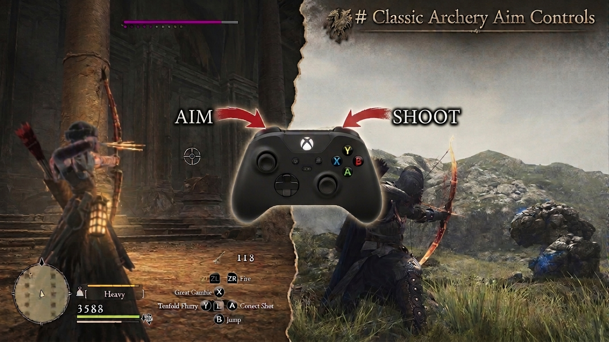

# Controles clássicos de mira

[](#)
[](#requisitos)
[](https://github.com/praydog/REFramework)
[](https://www.nexusmods.com/dragonsdogma2/mods/2553?tab=description)

**Idioma:** [English](README.md) · Português (Brasil)



Recria o esquema clássico de mira com arcos: segure LT para mirar, aperte RT para atirar enquanto continua mirando e solte LT para cancelar a mira sem disparar uma flecha.

## Índice

- [O que ele faz](#o-que-ele-faz)
- [Controles](#controles)
- [Requisitos](#requisitos)
- [Instalação](#instalação)
- [Controles recomendados do jogo](#controles-recomendados-do-jogo)
- [Warfarer](#warfarer)
- [Cloudburst Shot e Cataract Shot](#cloudburst-shot-e-cataract-shot)
- [Configurações](#configurações)
- [Desinstalação](#desinstalação)
- [Compatibilidade](#compatibilidade)
- [Relato de bugs](#relato-de-bugs)
- [Créditos e aviso legal](#créditos-e-aviso-legal)

## O que ele faz

Classic Aim Controls é um script Lua para o REFramework que restaura o comportamento clássico de mira com arcos no Dragon's Dogma 2.

Vocações e armas compatíveis:

- Archer
- Magick Archer
- Warfarer, somente enquanto estiver equipado com arco ou arco mágico; com outra arma, o Warfarer mantém os controles originais do jogo

O mod também funciona com:

- Objetos e criaturas carregados
- Piercing Dart
- Flechas de habilidade
- Cloudburst Shot
- Cataract Shot

Ele funciona na camada de entrada do jogo e segue os botões configurados pelo jogador no controle.

## Controles

| Controle | Ação |
|---|---|
| Segurar LT | Mirar |
| Apertar RT | Atirar e continuar mirando enquanto LT estiver pressionado |
| Soltar LT | Cancelar a mira sem disparar uma flecha |

Para objetos e criaturas carregados:

| Controle | Ação |
|---|---|
| LT | Mirar o arremesso |
| RT | Arremessar |
| Soltar LT | Cancelar a mira |

## Requisitos

- Dragon's Dogma 2 (PC)
- REFramework para Dragon's Dogma 2 (`dinput8.dll` na pasta do jogo)

## Instalação

### Fluffy Mod Manager

1. Arraste o `.zip` do mod para o Fluffy Mod Manager com Dragon's Dogma 2 selecionado.
2. Ative o mod.

### Instalação manual

Copie `reframework/autorun/ClassicAimControls.lua` para:

```text
<pasta do jogo>/reframework/autorun/
```

## Controles recomendados do jogo

Abra:

```text
REFramework > Script Generated UI > ClassicAimControls > Recommended game controls
```

Clique em **Apply classic aim controls** para alterar os vínculos do controle na memória do jogo para:

| Controle do jogo | Botão |
|---|---|
| Vocation Action | LT |
| Cancel | RB |
| Light Attack | RT |
| Grab | X |

Ative **Apply automatically on startup** e clique em **Save settings** para aplicar o layout sempre que o jogo iniciar.

Se você alterar os controles no próprio menu do jogo depois disso, clique em **Apply classic aim controls** novamente.

## Warfarer

Desde a versão 4.6, o mod atua somente quando o Warfarer estiver equipado com arco ou arco mágico.

Esse comportamento pode ser desativado com **Also work as Warfarer**.

## Cloudburst Shot e Cataract Shot

No jogo original, essas habilidades continuam disparando enquanto o jogador alterna repetidamente o controle de mira (LT pressionado/solto).

Com o mod:

- Cada pressionamento de RT adiciona outra saraivada ou flecha.
- Soltar LT cancela a habilidade.

### Cloudburst Shot

Cloudburst Shot possui um período de espera:

- A primeira saraivada é disparada 2,6 segundos após a ativação.
- Cada saraivada seguinte é disparada 2,5 segundos após a anterior.
- Pressionamentos de RT antes da próxima saraivada ficar disponível são ignorados, impedindo que um RT antecipado encerre a habilidade.

Controles disponíveis:

| Configuração | Padrão |
|---|---:|
| Cloudburst: first volley delay, from activation | 2,6 |
| Cloudburst: delay between volleys | 2,5 |

Os intervalos são independentes, e o primeiro pode ser menor que o segundo. Não é possível configurá-lo abaixo do tempo necessário para a habilidade ficar pronta (aproximadamente 0,3 segundos).

### Cataract Shot

Cataract Shot pode disparar assim que começa a preparar, sem tempo mínimo.

## Configurações

Abra:

```text
REFramework > Script Generated UI > ClassicAimControls > Settings
```

| Configuração | Descrição |
|---|---|
| Fire trigger | Ação vinculada ao RT. **Auto** aceita Grab, AttackS e AttackL. |
| Cancel with ActCancel | Cancela de forma limpa a mira preparada. Recomendado. |
| Aim again after the shot | Mira novamente caso o jogo solte a mira após o disparo. |
| Frames until the bow is ready | Começa em 0. |
| RT buffer | Começa em 0. Memoriza um pressionamento antecipado de RT até que o arco possa disparar. |
| Show debug | Mostra informações de depuração. |
| Record trace | Grava dados de diagnóstico para relatórios de bugs. |

Para depuração:

1. Ative **Record trace**.
2. Reproduza o problema.
3. Clique em **Save trace.json**.

O trace é salvo em:

```text
reframework/data/ClassicAimControls/
```

Clique em **Save settings** para armazenar as configurações em:

```text
reframework/data/ClassicAimControls/config.json
```

As configurações são carregadas sempre que o jogo inicia. `Enabled`, `Show debug` e `Record trace` nunca são salvos.

Para restaurar as configurações padrão, apague `config.json`.

## Desinstalação

- Desative o mod no Fluffy Mod Manager; ou
- Apague `reframework/autorun/ClassicAimControls.lua`.

## Compatibilidade

Não use este mod junto com **Vocational Control Presets** quando a opção **Apply automatically on startup** estiver ativada no Classic Aim Controls. Os dois mods alteram a mesma tabela de botões do jogo.

Para obter o mesmo layout com o Vocational Control Presets, crie uma configuração para Archer e Magick Archer com:

| Controle | Botão |
|---|---|
| Vocation Action | LT |
| Sheathe/Draw/Cancel | RB |
| Light Attack | RT |
| Grab | X |

## Relato de bugs

Informe:

- Versão do Dragon's Dogma 2
- Versão do REFramework
- Versão do mod
- Vocação e arma
- Habilidade utilizada
- Passos para reproduzir o problema
- `trace.json`, gerado por **Record trace** > **Save trace.json**

## Créditos e aviso legal

Autor: Luiz Gustavo Bringel Lisboa

Página do mod: [https://www.nexusmods.com/dragonsdogma2/mods/2553?tab=description](https://www.nexusmods.com/dragonsdogma2/mods/2553?tab=description)

Este é um mod não oficial feito por fãs e não é afiliado nem endossado pela Capcom. Dragon's Dogma 2, suas marcas comerciais e materiais protegidos por direitos autorais são propriedade da Capcom.

- REFramework, de praydog, é uma ferramenta/framework necessário.
- Fluffy Mod Manager é um gerenciador de mods recomendado.

Este README não afirma parceria entre os projetos.
